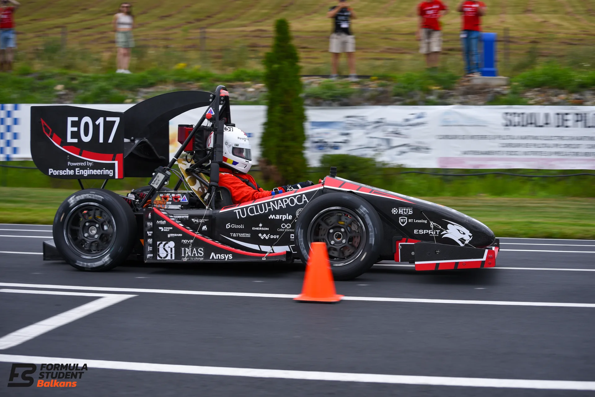
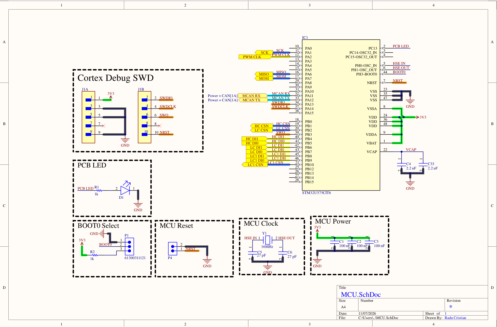

# Smart Power Distribution Module (PDM)

For this project, I want to build the control and monitoring system for a solid-state 12V Power Distribution Module, based on the PDM I have been working on for my Formula Student team.

On our car, we used to rely on mechanical relays and a physical fuse box. Whenever a fuse blew or we needed to check how much current something was drawing, there was no clean way to see it or recover without checking fuses by hand. This project replaces that setup with a smart, solid-state unit that powers, protects, and monitors all 12V loads on the car.

## Reference Docs

Hardware notes and schematics for our team's PDM:
- Link: https://docs.cloud.arttu-formulastudent.ro/Departments/Electrical/2026-2027/hardware/pdm/
- Username: `arttu-user`
- Password: `arttu-pass`

## What It Should Do

- **Split 12V Power Distribution:** Route power to both high-current loads (cooling fans, water pumps, motors) and low-current loads (control boards, sensors).
- **PWM Engine for Load Control:** Drive and regulate loads like fans and motors smoothly through the microcontroller's PWM engine, instead of only hard on/off switching.
- **SPI Communication:** Talk from the microcontroller to the smart high-side switch chips over SPI to toggle channels, set protection limits, and read diagnostics.
- **ADC Current & Health Monitoring:** Continuously measure channel current draw and temperature using internal ADC sensing. If a wire shorts or a load pulls too much current, shut off only that channel without killing the rest of the system.
- **CAN Bus Telemetry & Commands:** Connect to the car's CAN bus to receive on/off commands and broadcast live current draw, supply voltage, and channel fault status.

## Hardware Schematic

## Project Goal

By the end of the project, I want a working PDM setup on the bench that can drive real loads like fans or small motors through the PWM engine, catch shorts or overcurrent faults on its own, and stream everything cleanly over CAN before it goes on the car.
